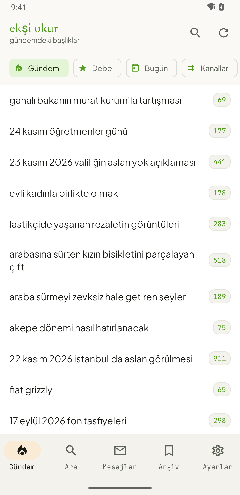

# Ekşi Okur

**Ekşi Okur** - Ekşi Sözlük için hafif, sade ve modern bir Android okuma istemcisi.

## Özellikler

- **Gündem**: Güncel başlıklar, popüler içerikler
- **Ara**: Kullanıcıların yazdığı içerik ve yazarları arayabilirsiniz
- **Mesajlar**: Kişisel mesajlaşma özelliği
- **Ayarlar**: Kişiselleştirme ve ayar menüsü

## Ekran Görüntüleri

- [Gündem ekranı](docs/screenshots/feed-light.png)
- [Ara ekranı](docs/screenshots/search.png)
- [Ayarlar ekranı](docs/screenshots/settings-light.png)
- [Gündem - Ayarlar](docs/screenshots/settings-dark.png)
- [Gündem - Ayarlar (koyu)](docs/screenshots/feed-dark.png)

## Lisans

[MIT License](LICENSE)

## Ekşi Sözlük

Ekşi Sözlük, Türkiye'de popüler online sözlük platformudur. Ekşi Okur, Ekşi Sözlüğün okuma deneyimini iyileştirmek için geliştirilmiş hafif bir Android istemcisidir.

- **Dil**: Türkçe
- **Platform**: Android
- **Geliştirici**: Cem TÜRKER (cmtrkr83)
- **GitHub**: https://github.com/cmtrkr83/eksi-okur
- **Buymeacoffee**: https://www.buymeacoffee.com/cmtrkr

## Geliştirme

Proje, GitHub'da açık kaynak olarak yönetilmektedir. Katkılar, öneriler ve hatalar bildiriminiz memnuniyetle kabul edilir.

## Lisans

Bu proje MIT Lisansına tabidir. [LICENSE dosyasını](LICENSE) inceleyin.

