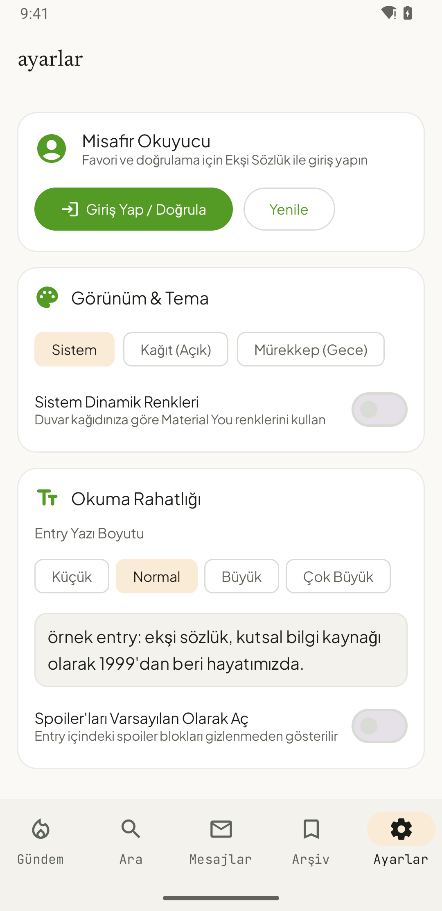
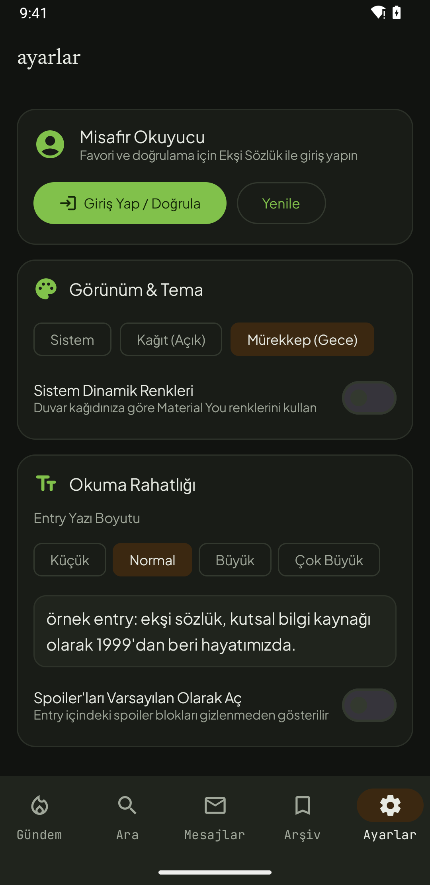

# Ekşi Okur

Tamamen kendim için yaptığım reklamsız sade bir ekşi istemcisi. Entry girebilir, mesaj gönderip silebilir yada sözlükte gezinebilirsiniz.

Ekşi Sözlük gündem, debe, başlıklar ve entry'ler için hızlı, sade ve modern Android okuma istemcisi.

<p align="center">
  <a href="https://www.buymeacoffee.com/cmtrkr"></a>
</p>

<p align="center">
  
  
  
  
</p>

## 📸 Ekran Görüntüleri

<p align="center">
  
  <br>
  <sub>Gündem ekranı — Açık tema</sub>
</p>

<p align="center">
  
  <br>
  <sub>Ayarlar ekranı — Açık tema</sub>
</p>

<p align="center">
  
  <br>
  <sub>Gündem ekranı — Koyu tema</sub>
</p>

<p align="center">
  
  <br>
  <sub>Ayarlar ekranı — Koyu tema</sub>
</p>

## ✨ Özellikler

- 📰 **Gündem** — Güncel başlıkları, popüler içerikleri ve bugün yazılanları takip et.
- 🔍 **Ara** — Başlık, yazar (@nick) veya kanal (#kanal) ile arama yap.
- 💬 **Mesajlar** — Diğer kullanıcılarla özel mesajlaş.
- 🔖 **Arşiv** — Beğendiğin başlıkları ve entry'leri kaydet.
- 🌗 **Açık / Koyu Tema** — Sistem, açık veya koyu tema seçeneği.
- 📝 **Entry Yaz** — Ekşi Sözlük'e entry gir.
- ⚡ **Hafif ve Hızlı** — Sade arayüz, hızlı okuma deneyimi.

## 📚 Konular ve Kanallar

Ekşi Okur'da şu konu ve kanal kategorileri mevcut:

| Kategori | Açıklama |
|----------|----------|
| 🔥 Gündem | Güncel ve popüler başlıklar |
| ⭐ Debe | En beğenilen başlıklar |
| 📅 Bugün | Bugün yazılan entry'ler |
| 🏷️ Kanallar | Spor, Siyaset, Teknoloji, Sinema, Müzik, Bilim, Edebiyat, Ekonomi, Tarih, Oyun, Eğitim, Sağlık, Sanat, Otomobil |

Her konuda **Tümü**, **Popüler**, **Şükela** ve **Bugünün Şükelası** filtreleri kullanılabilir.

## 🏗️ Proje Yapısı

```text
app/src/main/java/com/example/
├── MainActivity.kt          # Ana navigasyon ve ekranlar
├── EksiAppContainer.kt      # Bağımlılık enjeksiyonu
├── data/
│   ├── local/               # Veritabanı (Room) ve tercihler
│   ├── model/               # Veri modelleri
│   ├── network/             # Ekşi Sözlük HTML ayrıştırıcı ve ağ
│   └── repository/          # Veri katmanı
├── ui/
│   ├── components/          # Üstün bileşenler (EntryCard, TopicListItem, vb.)
│   ├── screens/             # Ekranlar (Feed, Topic, Author, Search, vb.)
│   ├── theme/               # Renk, tipografi ve tema
│   └── viewmodel/           # Ekran ViewModel'leri
└── res/                     # Kaynaklar (font, drawable, values)
```

## 🚀 Build

Gereksinimler: JDK 17, Android SDK 34, Gradle 9.3.1+ (veya Android Studio).

```bash
./gradlew assembleDebug
```

Debug APK`'yı `app/build/outputs/apk/debug/app-debug.apk` konumunda bulabilirsiniz.

## 📱 Ekranlar

| Ekran | Açıklama |
|-------|----------|
| Gündem | Güncel başlıklar, debe, bugün ve kanallar |
| Ara | Başlık, yazar ve kanal arama |
| Mesajlar | Kişisel mesajlaşma |
| Arşiv | Kaydedilen başlıklar ve entry'ler |
| Ayarlar | Tema, giriş yap/çıkış yap, okuma ayarları |

## 📄 Lisans

[](LICENSE)

Bu proje MIT lisansı altında lisanslanmıştır. Ayrıntılar için [LICENSE](LICENSE) dosyasına bakın.

## 👤 Geliştirici

**Cem TÜRKER**  
GitHub: [cmtrkr83](https://github.com/cmtrkr83)  
Buymeacoffee: [cmtrkr](https://www.buymeacoffee.com/cmtrkr)

İşinize yaradıysa bir kahve ısmarlamak isterseniz memnuniyetle kabul ederim. ☕
